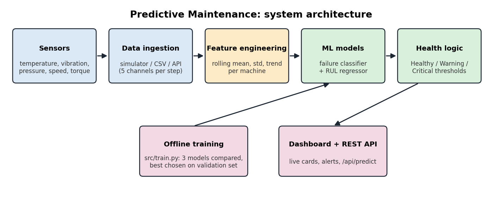

# Predictive Maintenance for Industrial Machines

A machine-learning system that reads sensor data from industrial machines, predicts **whether a machine is
about to fail** and **how many steps of life it has left (RUL)**, and shows the result on a live web
dashboard with alerts. Built in Python (pandas, scikit-learn, Flask) as an industrial internship project.



## Problem

Unplanned machine breakdowns are expensive. Fixed-schedule maintenance wastes parts and still misses
failures. This project predicts failures from sensor trends so maintenance can be scheduled *just in time*.

## What it does

| Part | Description |
|---|---|
| Data | Simulated run-to-failure data for 150 machines (about 40,000 readings; 5 sensors: temperature, vibration, pressure, rotational speed, torque), including noise, per-machine differences, a load cycle and random vibration spikes |
| Features | Rolling mean, standard deviation and trend per sensor, computed per machine (20 features) |
| Models | Logistic Regression, Random Forest, Gradient Boosting are compared; the best on the validation set is kept. A Random Forest regressor estimates remaining useful life |
| Evaluation | Machines are split 70/15/15 into train/validation/test, so no machine appears in two splits |
| Dashboard | Flask app with a simulated fleet of 6 machines: health status, failure risk, RUL estimate, sparklines, alerts |
| API | `POST /api/predict` scores a machine from its recent readings |

## Results (held-out test machines)

| Model | Precision | Recall | F1 | ROC-AUC |
|---|---|---|---|---|
| Logistic Regression | 0.527 | 0.997 | 0.690 | 0.988 |
| **Random Forest (selected)** | **0.629** | **0.930** | **0.751** | **0.983** |
| Gradient Boosting | 0.623 | 0.923 | 0.744 | 0.983 |

* "Positive" means a failure within the next 30 steps. Only 11% of readings are positive.
* Random Forest catches 93% of upcoming failures (642 of 690) with 378 false alarms among 5,594 normal readings.
* Remaining useful life (capped at 150): RMSE 18.0, MAE 13.1; RMSE 11.8 when the machine is within 30 steps of failure.
* Speed: about 22 ms per prediction (model only), about 34 ms end to end including feature calculation; about 44,000 rows/s in batch.
* Robustness: F1 stays around 0.70 to 0.74 with up to 3x extra sensor noise or 30% missing readings.

Full tables: [`results/performance_results.md`](results/performance_results.md) and
[`results/metrics.json`](results/metrics.json). Figures are in [`docs/figures/`](docs/figures/).

## Setup

```bash
git clone <your-repo-url>
cd predictive-maintenance
python3 -m venv .venv && source .venv/bin/activate      # Windows: .venv\Scripts\activate
pip install -r requirements.txt
```

## Usage

```bash
python -m src.train          # simulate data, train and evaluate models (about 1-2 minutes)
python -m src.benchmark      # speed, memory and robustness tests
python app/app.py            # dashboard at http://127.0.0.1:5000
python -m unittest discover -s tests -v    # run the tests
```

`python -m src.train` must run once before the dashboard, because trained models are not stored in git.

### API example

```bash
curl -X POST http://127.0.0.1:5000/api/predict -H "Content-Type: application/json" -d '{
  "readings": [
    {"temperature": 82, "vibration": 1.4, "pressure": 94, "rotational_speed": 1420, "torque": 47},
    {"temperature": 84, "vibration": 1.6, "pressure": 93, "rotational_speed": 1405, "torque": 48}
  ]}'
```

Send readings oldest first. The response contains `failure_probability`, `status` and `estimated_rul`.

## Project structure

```
src/
  config.py          constants: sensors, horizon, thresholds
  data_generator.py  machine simulator and dataset generator
  features.py        rolling-window feature engineering
  train.py           model comparison, evaluation, figures, saving
  predict.py         model loading and prediction helpers
  benchmark.py       latency, throughput, memory, noise and missing-data tests
app/
  app.py             Flask dashboard and REST API
  templates/index.html
tests/               unit and API tests
docs/                architecture diagram script and generated figures
data/                small sample of the simulated data
results/             metrics and performance test results
```

## Design decisions and constraints

* **Split by machine, not by row.** Random row splits would put neighbouring readings of one machine in both
  train and test and inflate scores.
* **Recall matters more than precision.** A missed failure costs more than a false alarm, so class weights
  are balanced and the dashboard uses two thresholds (Warning at 35%, Critical at 65%).
* **Missing sensor data** is handled with median imputation inside the model pipeline.
* **Causal features.** Features use only current and past readings, so the same code works on live data.

## Limitations

* The data is **simulated**, so scores show that the pipeline works, not how it would perform on a real plant.
  Real data would need retraining and re-tuning of the thresholds.
* Precision is about 63%: roughly one in three alerts is a false alarm.
* Simulated degradation is smooth; real failures can also be sudden.

## Using real data

`python -m src.train --data your_file.csv` accepts a CSV with columns `machine_id`, `step`, `rul` and the five
sensor columns listed in `src/config.py`. Public run-to-failure datasets such as NASA C-MAPSS or AI4I 2020 can
be mapped to this layout by renaming columns and adjusting `SENSORS` in `src/config.py`.

## Future work

* Train on a real public dataset and compare with the simulated results
* LSTM or other sequence models on raw sensor windows
* Connect live sensors over MQTT instead of the simulator
* Cost-based threshold tuning using real downtime and repair costs
